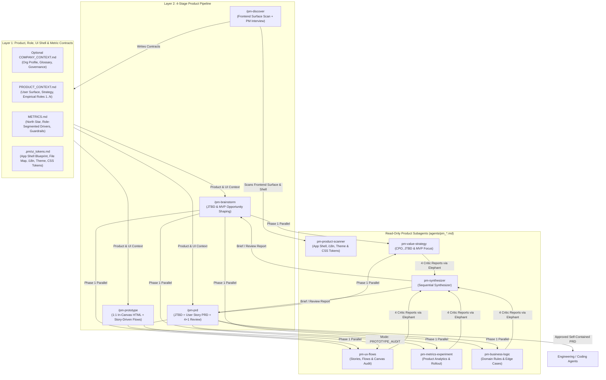

# EGM for Product Managers (`egm-product`) — Architecture & Specification (v0.5.0)

*   **Author:** stas
*   **Status:** Approved (v0.5.0)
*   **Date:** 2026-11-13

--------------------------------------------------------------------------------

## Overview

`egm-product` is a pure-product AI framework built on the Elephant-Goldfish Model (`egm`). Whereas engineering specs focus on technical design, database schemas, and backend architecture, `egm-product` stays strictly on the **Product Management** side: mapping company context, empirical user roles, UI App Shell blueprints, and metric trees; challenging Jobs-to-be-Done (JTBD) and cutting MVP bloat; writing and reviewing JTBD + User Story PRDs with story-driven screen states; and generating interactive zero-build HTML prototypes rendered 1:1 inside the real product interface canvas.

`egm-product` separates **Layer 1: Product, Role, UI Shell & Metric Context Contracts** (optional reusable `COMPANY_CONTEXT.md`, per-product `PRODUCT_CONTEXT.md` and `METRICS.md`, plus `.pm/ui_tokens.md` for 1:1 in-canvas prototyping) from **Layer 2: 4-Stage Product Pipeline, Frontend Surface & App Shell Scanner (`pm-product-scanner`), and the 4 + 1 Product Goldfish Swarm** (`pm-value-strategy`, `pm-ux-flows`, `pm-metrics-experiment`, `pm-business-logic` -> `pm-synthesizer`). Under **`Zero Assumed Personas`**, roles are mapped empirically (`1` to `N` rows in `Active Product Roles & Workflows`), and multi-role branching activates downstream **only** when a feature spans `>= 2` distinct roles.

## The Problem

1.  **Pseudo-Technical Bloat in Product Workflows**: Forcing Product Managers to track database schemas, source-code `[file:line]` citations, and git commit SHAs inside PRDs distracts from user jobs, business rules, and product quality.
2.  **Weak JTBD & User Story Decomposition**: AI-drafted PRDs often jump straight to feature bullet lists without grounding capabilities in explicit **Jobs-to-be-Done (`JOB-xx`)**, current workaround friction, and atomic role-owned **User Stories (`US-xx`)** traceable to Critical User Journeys (`CUJs`) and business rules (`REQ-xxx`).
3.  **Generic Prototypes Disconnected from the Host Product UI**: Standalone HTML mockups styled with generic aesthetic presets fail to show how a feature actually fits inside the product's real sidebar/header App Shell, default `i18n` locale copy, active runtime theme, and target screen layout.
4.  **Rigid Boilerplate State Checklists**: Hardcoding fixed boilerplate state tables (`Default / Loading / Empty / Error`) ignores the real scenarios, multi-step flows, edge cases, and role views dictated organically by each PRD's User Stories and business rules.

## Goals

*   **Strict Product-First Boundary + Real Frontend Grounding**: Keep `egm-product` 100% focused on user value, JTBD, User Stories, empirical role workflows, business rules, and product analytics—using frontend inspection (`pm-product-scanner` and `/pm-prototype`) exclusively to reproduce the real user-facing App Shell, `i18n` copy, active theme, and `:root` CSS tokens (`.pm/ui_tokens.md`).
*   **Traceable `JTBD -> User Stories -> CUJs & REQ-*` Hierarchy**: Require every PRD to define numbered `JOB-xx` Job Stories (plus current workaround friction), decompose them into atomic role-owned `US-xx` User Stories across all participating empirical roles, and trace every `US-xx` into concrete `Given / When / Then` `CUJs` and `REQ-xxx` rules.
*   **Non-Deterministic, Story-Driven Screen States & Scenarios**: Let the agent derive `## 5. UI Placement, Screen States & Copy` in `prd.md` and interactive states/scenarios in `prototype.html` organically from the PRD's JTBD, User Stories, and business rules rather than rigid boilerplate state checklists or external aesthetic rulebooks.
*   **1:1 In-Canvas Zero-Build Prototyping**: Render `prototype.html` directly inside the host product's authenticated/route-group App Shell and target screen with walkable User Story interactions, zero external network dependencies, and fresh-context verification via `pm-ux-flows` (`Mode: PROTOTYPE_AUDIT`).
*   **Self-Contained Product Deliverables (`Signal Over Padding`)**: Keep specs concise without arbitrary line or file-count caps, and place a self-contained **Engineering Handoff Directive** and `Open Questions for Engineering` in `prd.md` with zero hard dependencies on external plugins.

## Non-Goals

*   **Database Schema, API Route, or Backend Architecture Design**: Technical implementation design belongs exclusively to engineering downstream of an approved PRD.
*   **Mutating Production Source Code or Build Manifests**: `egm-product` never edits host application code or `package.json`.

--------------------------------------------------------------------------------

## Technical Plan (Architecture)

### Key Architectural Invariants

1.  **Subagent Roster (6 Read-Only Product Personas)**:
    *   [`agents/pm_product_scanner.md`](../../agents/pm_product_scanner.md): Stage 1 frontend surface and `.pm/ui_tokens.md` scanner (authenticated/route-group App Shell, `i18n` locale dictionaries, active runtime theme, reusable UI primitives, and workspace-root-relative `Frontend Canvas File Map`; zero DB/backend dumps).
    *   [`agents/pm_value_strategy.md`](../../agents/pm_value_strategy.md): Pillar 1 — Problem & JTBD (`JOB-xx` + workaround friction) sharpness, `Demand Evidence Posture` (`EVIDENCE_BACKED` vs. `UNVALIDATED_ASSUMPTION` + validation/kill gate), strategic fit, and cutting MVP bloat.
    *   [`agents/pm_ux_flows.md`](../../agents/pm_ux_flows.md): Pillar 2 — Bidirectional `JOB-xx -> US-xx -> CUJ & REQ-xxx` traceability, empirical role fit (`Zero Assumed Personas`), conditional `Cross-Role Handoffs & Permissions`, story-driven screen states, and `Mode: PROTOTYPE_AUDIT` on `prototype.html`.
    *   [`agents/pm_metrics_experiment.md`](../../agents/pm_metrics_experiment.md): Pillar 3 — Falsifiable causal chain, anti-vanity metrics, `Role Segment` attribution, counter-metric guardrails, domain product events, and rollout criteria.
    *   [`agents/pm_business_logic.md`](../../agents/pm_business_logic.md): Pillar 4 — Functional completeness, business rules, user-facing edge cases, permissions/approvals, AI/search quality expectations, and `Open Questions for Engineering`.
    *   [`agents/pm_synthesizer.md`](../../agents/pm_synthesizer.md): Phase 2 sequential synthesizer producing `opportunity_brief.md` or `pm_review_report.md`.
2.  **Gate Neutrality (`Progression Gates` vs. `Trade-Off Gates`)**:
    *   Defined in [`resources/pm_execution_instructions.md`](../../resources/pm_execution_instructions.md): mechanical progression gates mark Option 1 `(Recommended)`, whereas product scope forks and `ESCALATE` decisions omit `(Recommended)` (`Owner Decides Product Scope`).

--------------------------------------------------------------------------------

## Detailed Implementation Inventory

*   **Manifests & Extensions**: `plugin.json`, `.claude-plugin/plugin.json`, `.claude-plugin/marketplace.json`, `.codex-plugin/plugin.json`, `.agents/plugins/marketplace.json`, `qwen-extension.json`, `gemini-extension.json`, [`QWEN.md`](../../QWEN.md), [`GEMINI_EXTENSION.md`](../../GEMINI_EXTENSION.md), `rules/AGENTS.md`.
*   **Shared Contracts, Templates & Commands**: [`resources/pm_execution_instructions.md`](../../resources/pm_execution_instructions.md), [`resources/document_standards/prd-standard.md`](../../resources/document_standards/prd-standard.md), 5 templates in `resources/templates/*.template.md`, and 4 slash commands in `resources/commands/pm-*.md`.
*   **Subagents & Claude Adapters**: 6 canonical personas in `agents/pm_*.md` and 6 read-only adapters in `.claude-plugin/agents/pm_*.md`.
*   **Skills**: [`pm-discover`](../../skills/pm-discover/SKILL.md), [`pm-brainstorm`](../../skills/pm-brainstorm/SKILL.md), [`pm-prd`](../../skills/pm-prd/SKILL.md), and [`pm-prototype`](../../skills/pm-prototype/SKILL.md).
*   **Packaging & Verification**: [`scripts/pack_plugin.py`](../../scripts/pack_plugin.py), [`scripts/install.py`](../../scripts/install.py), [`tests/unit/test_plugin_structure.py`](../../tests/unit/test_plugin_structure.py), and [`tests/unit/test_pack_and_install.py`](../../tests/unit/test_pack_and_install.py).
