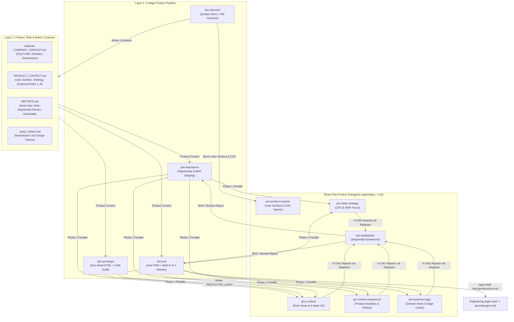

# EGM for Product Managers (`egm-product`) — Architecture & Specification (v0.4.0)

*   **Author:** stas
*   **Status:** Approved (v0.4.0)
*   **Date:** 2026-11-12

--------------------------------------------------------------------------------

## Overview

`egm-product` is a pure-product AI framework built on the Elephant-Goldfish Model (`egm`). Whereas engineering `egm` (`/egm-draft`, `/egm-review`) solves technical design, database schemas, and backend architecture, `egm-product` stays strictly on the **Product Management** side: mapping company context, empirical user roles, and metric trees; challenging feature value and cutting MVP bloat; writing and reviewing user-focused PRDs; and generating interactive zero-build HTML prototypes.

`egm-product` separates **Layer 1: Product, Role & Metric Context Contracts** (optional reusable `COMPANY_CONTEXT.md`, per-product `PRODUCT_CONTEXT.md` and `METRICS.md`, plus `.pm/ui_tokens.md` for prototyping) from **Layer 2: 4-Stage Product Pipeline, Light Surface Scanner (`pm-product-scanner`), and the 4 + 1 Product Goldfish Swarm** (`pm-value-strategy`, `pm-ux-flows`, `pm-metrics-experiment`, `pm-business-logic` -> `pm-synthesizer`). Under the **`Zero Assumed Personas`** invariant, roles are mapped empirically (`1` to `N` rows in `Active Product Roles & Workflows`), and multi-role branching activates downstream **only** when a feature spans `>= 2` distinct roles.

## The Problem

1.  **Pseudo-Technical Bloat in Product Workflows**: Forcing Product Managers to track database schemas, source-code `[file:line]` citations, and git commit SHAs inside PRDs duplicates downstream engineering specs (`/egm-draft`) while distracting from actual product quality.
2.  **Feature Creep & Unvalidated Demand**: Without antagonistic product review, AI-drafted PRDs rubber-stamp bloated scope, skip demand validation/kill criteria, and rely on vanity metrics without guardrails.
3.  **Stereotyped or Flat Personas**: Assuming hardcoded role behaviors ("support = queues", "executives = dashboards") fails on real internal and B2B products whose role topologies vary empirically across organizations.
4.  **High Prototyping Friction**: Bundler-coupled prototypes fail on PM machines or dirty working trees when stakeholders simply need to click through the 4 UI states (and role views) in a browser.

## Goals

*   **Strict Product-vs-Engineering Boundary**: Keep `egm-product` 100% focused on user value, empirical role workflows, UX states, business rules, and product analytics—using light repo skimming (`pm-product-scanner`) only to understand live user-facing screens and visual CSS tokens (`.pm/ui_tokens.md`).
*   **Streamlined 4-Stage Pipeline**: Deliver a focused workflow (`/pm-discover` -> `/pm-brainstorm` -> `/pm-prd` with built-in review -> `/pm-prototype`) with zero redundant technical-grooming stages.
*   **4 + 1 Pure-Product Goldfish Swarm**: Stress-test Opportunity Briefs and PRDs across four genuine product lenses (`pm-value-strategy`, `pm-ux-flows`, `pm-metrics-experiment`, `pm-business-logic`) synthesized sequentially by `pm-synthesizer`, with neutral `Owner Decides Product Scope` trade-off gates.
*   **Empirical Role & Organizational Context (`Zero Assumed Personas`)**: Support optional `COMPANY_CONTEXT.md` (`--context <path>`) and elastic `1..N` role mapping in `PRODUCT_CONTEXT.md`, activating cross-role handoffs, role-segmented metrics, and `prototype.html` role switching only when `>= 2` roles diverge.
*   **Direct PRD-to-Engineering Handoff (`/egm-draft` or Coding Agents)**: Place a top-level **Engineering Handoff Directive** and explicit `Open Questions for Engineering` in `prd.md` so `/egm-draft` (from the optional `egm` companion plugin, or any coding agent) owns technical architecture in `docs/designs/<feature-slug>.md`.

## Non-Goals

*   **Database Schema, API Route, or Source-Code Auditing**: Technical implementation design belongs exclusively to engineering (`/egm-draft`).
*   **Mutating Production Source Code or Build Manifests**: `egm-product` never edits host application code, `package.json`, or `egm-bootstrap` `README.md` contracts.

--------------------------------------------------------------------------------

## Technical Plan (Architecture)

### Key Architectural Invariants

1.  **Subagent Roster (6 Read-Only Product Personas)**:
    *   [`agents/pm_product_scanner.md`](../../agents/pm_product_scanner.md): Stage 1 light user-surface and `.pm/ui_tokens.md` scanner (`<= 20` files, supports `--scope <subdir>` and `--context <path>`, zero DB/backend dumps).
    *   [`agents/pm_value_strategy.md`](../../agents/pm_value_strategy.md): Pillar 1 — Problem sharpness, `Demand Evidence Posture` (`EVIDENCE_BACKED` vs. `UNVALIDATED_ASSUMPTION` + validation/kill gate), strategic fit, and cutting MVP bloat.
    *   [`agents/pm_ux_flows.md`](../../agents/pm_ux_flows.md): Pillar 2 — Step reduction, empirical role fit (`Zero Assumed Personas`), conditional `Cross-Role Handoffs & Permissions`, 4-state UX matrix, and `Mode: PROTOTYPE_AUDIT` on `prototype.html`.
    *   [`agents/pm_metrics_experiment.md`](../../agents/pm_metrics_experiment.md): Pillar 3 — Falsifiable causal chain, anti-vanity metrics, `Role Segment` attribution, counter-metric guardrails, domain product events, and rollout criteria.
    *   [`agents/pm_business_logic.md`](../../agents/pm_business_logic.md): Pillar 4 — Functional completeness, business rules, user-facing edge cases, permissions/approvals, AI/search quality expectations, and `Open Questions for Engineering`.
    *   [`agents/pm_synthesizer.md`](../../agents/pm_synthesizer.md): Phase 2 sequential synthesizer producing `opportunity_brief.md` or `pm_review_report.md`.
2.  **Gate Neutrality (`Progression Gates` vs. `Trade-Off Gates`)**:
    *   Defined in [`resources/pm_execution_instructions.md`](../../resources/pm_execution_instructions.md): mechanical progression gates mark Option 1 `(Recommended)`, whereas product scope forks and `ESCALATE` decisions omit `(Recommended)` (`Owner Decides Product Scope`).

--------------------------------------------------------------------------------

## Detailed Implementation Inventory

*   **Manifests & Extensions**: [`plugin.json`](../../plugin.json), [`.claude-plugin/plugin.json`](../../.claude-plugin/plugin.json), [`.claude-plugin/marketplace.json`](../../.claude-plugin/marketplace.json), [`.codex-plugin/plugin.json`](../../.codex-plugin/plugin.json), [`.agents/plugins/marketplace.json`](../../.agents/plugins/marketplace.json), [`qwen-extension.json`](../../qwen-extension.json), [`gemini-extension.json`](../../gemini-extension.json), [`QWEN.md`](../../QWEN.md), [`GEMINI_EXTENSION.md`](../../GEMINI_EXTENSION.md), [`rules/AGENTS.md`](../../rules/AGENTS.md).
*   **Shared Contracts, Templates & Commands**: [`resources/pm_execution_instructions.md`](../../resources/pm_execution_instructions.md), [`resources/document_standards/prd-standard.md`](../../resources/document_standards/prd-standard.md), 5 templates in `resources/templates/*.template.md`, and 4 slash commands in `resources/commands/pm-*.md`.
*   **Subagents & Claude Adapters**: 6 canonical personas in `agents/pm_*.md` and 6 read-only adapters in `.claude-plugin/agents/pm_*.md`.
*   **Skills**: [`pm-discover`](../../skills/pm-discover/SKILL.md), [`pm-brainstorm`](../../skills/pm-brainstorm/SKILL.md), [`pm-prd`](../../skills/pm-prd/SKILL.md), and [`pm-prototype`](../../skills/pm-prototype/SKILL.md).
*   **Packaging & Verification**: [`scripts/pack_plugin.py`](../../scripts/pack_plugin.py), [`scripts/install.py`](../../scripts/install.py), [`tests/unit/test_plugin_structure.py`](../../tests/unit/test_plugin_structure.py), and [`tests/unit/test_pack_and_install.py`](../../tests/unit/test_pack_and_install.py).
