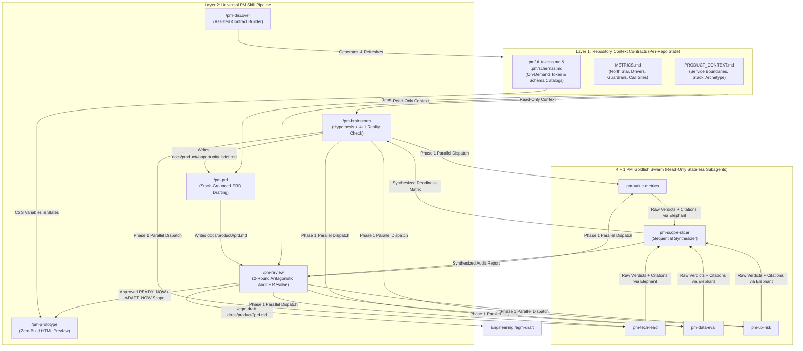

# EGM for Product Managers (`egm-product`)

*   **Author:** stas
*   **Status:** Approved
*   **Date:** 2026-11-09

--------------------------------------------------------------------------------

## Overview

`egm-product` is an AI-native Product Management plugin built on the Elephant-Goldfish Model (`egm`) architecture. It automates core product management workflows—context discovery, opportunity brainstorming, stack-grounded PRD drafting, antagonistic cross-functional review, and interactive HTML prototyping—inside any existing software repository.

In engineering `egm`, a deep-context agent (the Elephant) drafts technical specifications while fresh-context subagents (the Goldfish) audit them for engineering risks. `egm-product` adapts this architecture for product managers working in local repository builds alongside coding agents. It introduces a two-layer separation between **Repository Context Contracts** (`PRODUCT_CONTEXT.md` and `METRICS.md`, discovered per product repository) and a **4 + 1 Universal PM Goldfish Swarm** (`pm-value-metrics`, `pm-tech-lead`, `pm-data-eval`, `pm-ux-risk` followed by `pm-scope-slicer`). This separation allows a single plugin to operate across any internal product in an organization—whether an internal platform service such as Search-as-a-Service, an operational dashboard, or an internal tool designed for future B2B commercialization.

## The Problem

Product managers building features on top of complex existing tech stacks face four recurring bottlenecks that standard AI chat prompts fail to solve:

1.  **Late Discovery of Engineering, Data, and Security Blockers**: Product managers write PRDs in isolation from the codebase, specifying requirements that assume data fields are populated, upstream services pass specific payloads, or permissions are enforced at retrieval time. They only discover in sprint grooming (via the Tech Lead), staging QA (via data engineers), or pre-launch security reviews that key parts of the feature cannot be built right now (`BLOCKED_NOW`) or require cross-team migrations—wasting days of spec writing and delaying delivery.
2.  **Unverified Metric Targets**: Traditional PRDs treat success metrics as a fill-in-the-blank section added after the feature is already chosen. PMs write targets ("increase engagement by 15%") without a falsifiable causal chain to business outcomes and without checking whether the codebase actually emits the telemetry events and entity correlation keys needed to measure before-and-after impact.
3.  **Hallucinated Discovery When Prompting AI Without System Grounding**: Asking a general-purpose LLM to "predict user needs" or "write a PRD" without repository and operational context yields generic feature suggestions disconnected from what the backend already stores, computes, or exposes. Conversely, hardcoding a single product's domain rules into custom prompts makes the workflow unusable for other product teams in the company.
4.  **High Friction in Building Realistic Product Previews**: PMs who try to prototype directly inside a production codebase get blocked by local build toolchains, database migrations, authentication wrappers, or dirty git trees. PMs who prototype in external mock tools produce screens that ignore the product's actual design tokens, data schemas, and empty/error/fallback states.

`egm-product` solves these problems by enforcing a mandatory `METRICS.md` business-impact contract (with an inline bootstrap path for uninstrumented repositories), running an automatic 4 + 1 Cross-Functional Reality Check on every proposed requirement (`READY_NOW`, `ADAPT_NOW`, or `BLOCKED_NOW`), isolating blocked work into a Prerequisite Ledger, and generating zero-build interactive HTML prototypes inside an isolated sandbox after PRD review completes.

## Goals

*   **Domain-Agnostic Reusability Across Repositories**: Provide a single portable plugin (`egm-product`) whose skills and Goldfish subagents contain zero hardcoded product assumptions, adapting dynamically to any repository by reading `PRODUCT_CONTEXT.md` and `METRICS.md`.
*   **Assisted Repository & Metric Discovery (`/pm-discover`)**: Combine a single-pass codebase scan (extracting schemas, routes, service boundaries, telemetry call sites, and UI design tokens) with a targeted PM interview (capturing North Star metrics, baselines, target deltas, guardrails, and strategic posture) into versioned `PRODUCT_CONTEXT.md` and `METRICS.md` contracts capped at 300 lines each.
*   **Automatic 4 + 1 Cross-Functional Reality Check**: Evaluate every proposed product requirement across four parallel diagnostic Goldfish lenses (`pm-value-metrics`, `pm-tech-lead`, `pm-data-eval`, `pm-ux-risk`) and one sequential synthesizer (`pm-scope-slicer`), classifying each requirement (`REQ-ID`) into `READY_NOW`, `ADAPT_NOW`, or `BLOCKED_NOW` backed by `[file:symbol_or_line]` citations.
*   **Cold-Start Safe Metric & Telemetry Enforcement**: Require every feature in `/pm-brainstorm` and `/pm-prd` to bind a falsifiable causal chain to `METRICS.md`, while avoiding cold-start deadlocks via an Inline Bootstrap Recovery Gate and classifying missing in-code telemetry as `INSTRUMENTATION_REQUIRED` (`ADAPT_NOW` work added automatically to the MVP slice).
*   **Engineering-Compatible PRD Handoff**: Produce structured PRD artifacts (`docs/product/<feature-slug>/prd.md`) that separate active MVP scope (`READY_NOW` and `ADAPT_NOW`) from the `## Prerequisite Ledger (BLOCKED_NOW)` while retaining section compatibility with engineering `/egm-draft` (`/egm-draft docs/product/<feature-slug>/prd.md`).
*   **Zero-Host-Mutation Interactive Prototyping (`/pm-prototype`)**: After `/pm-review` locks PRD scope, generate a standalone, zero-build HTML/CSS/JS prototype (`docs/product/<feature-slug>/prototype.html`) covering the core Day-1 workflow across 3–4 switchable states using extracted repository CSS custom properties, with embedded UI craft rules and progressive headless-browser / `stageshow` verification when available.

## Non-Goals

*   **Writing Production Application Code**: `egm-product` does not implement production backend services, database migrations, or frontend application code inside the host repository; production engineering design and coding remain the responsibility of `/egm-draft` and standard engineering workflows.
*   **Replacing External Analytics or Issue-Tracking Infrastructure**: The plugin ingests context provided by the PM and audits telemetry emission in source code, but does not host analytics pipelines, A/B testing engines, or ticket databases.
*   **Mutating Host Repository Build Manifests or Documentation Contracts**: `/pm-discover` and `/pm-prototype` never modify existing `README.md` contracts generated by `egm-bootstrap`, `package.json` dependencies, or application source files.

## Open Questions

*   *None at this stage. All core scope, swarm topology (4 + 1), cold-start metric handling (`INSTRUMENTATION_REQUIRED` as `ADAPT_NOW`), and pipeline ordering (`pm-prd` → `pm-review` → `pm-prototype`) decisions were resolved in `concepts_brief.md`.*

## Critical User Journeys (CUJs)

### CUJ 1: Onboarding an Existing Product Repository via `/pm-discover`

*   **Given**: A product manager opens an existing internal product repository (for example, an internal Search-as-a-Service repo or an internal operations portal) where `PRODUCT_CONTEXT.md` and `METRICS.md` do not yet exist.
*   **When**: The PM invokes `/pm-discover`.
*   **Then**:
    1.  The Elephant executes a single-pass read-only scan of repository manifests, existing `README.md` contracts, database/API schemas, analytics emission call sites, and UI stylesheet tokens, writing bounded catalogs to `.pm/ui_tokens.md` (max 200 lines) and `.pm/schemas.md` (max 400 lines).
    2.  The Elephant prompts the PM to fill in the business-owned `[NEEDS_PM_INPUT]` fields that code cannot know (North Star metric, baseline, target delta, counter-metric guardrails, upstream/downstream team ownership, and whether the product is strictly internal or a future B2B candidate).
    3.  The skill reconciles each PM-defined `Metric ID` against the discovered code emitters in memory and writes `PRODUCT_CONTEXT.md` and `METRICS.md` (each under 300 lines with `generated_at_commit` frontmatter), separating machine-discovered sections from human-curated sections so subsequent `/pm-discover` runs refresh code citations without overwriting PM strategy.

### CUJ 2: Brainstorming a Feature with Automatic 4 + 1 Reality Check (`/pm-brainstorm`)

*   **Given**: A PM invokes `/pm-brainstorm` in a repository to propose a new feature (or runs `/pm-brainstorm` in a repo where `METRICS.md` is missing).
*   **When**: The PM describes the desired feature and confirms readiness at the hypothesis checkpoint gate.
*   **Then**:
    1.  If `PRODUCT_CONTEXT.md` or `METRICS.md` is missing, the skill saves the user's initial prompt and presents an Inline Bootstrap Recovery Gate that reads and executes `skills/pm-discover/SKILL.md` in-thread before resuming `/pm-brainstorm`.
    2.  The Elephant spawns the 4 read-only diagnostic Goldfish subagents (`pm-value-metrics`, `pm-tech-lead`, `pm-data-eval`, `pm-ux-risk`) in parallel, each reading `PRODUCT_CONTEXT.md`, `METRICS.md`, and up to 8 targeted source files. The Elephant retries any failed Phase 1 subagent once.
    3.  Once the 4 diagnostic subagents report back, the Elephant invokes the read-only `pm-scope-slicer` synthesizer subagent with their raw reports and Execution Audit statuses, then writes the compiled result to `docs/product/<feature-slug>/opportunity_brief.md` (classifying every requirement `REQ-001`, `REQ-002`, ... into `READY_NOW`, `ADAPT_NOW`, or `BLOCKED_NOW` under strict `BLOCKED_NOW > ADAPT_NOW > READY_NOW` precedence).
    4.  The PM reviews the Scope Triage Gate to approve which `ADAPT_NOW` counter-proposals enter the Day-1 MVP and which `BLOCKED_NOW` items move to the Prerequisite Ledger.

### CUJ 3: Drafting and Reviewing a Stack-Grounded PRD (`/pm-prd` and `/pm-review`)

*   **Given**: An approved `docs/product/<feature-slug>/opportunity_brief.md` with triaged `READY_NOW`, `ADAPT_NOW`, and `BLOCKED_NOW` requirements.
*   **When**: The PM runs `/pm-prd` followed by `/pm-review`.
*   **Then**:
    1.  `/pm-prd` drafts `docs/product/<feature-slug>/prd.md` section-by-section with interactive approval gates, placing active `READY_NOW` and `ADAPT_NOW` requirements (plus any required telemetry instrumentation tasks and evaluation datasets) in the main specification and isolating blocked items below `## Prerequisite Ledger (BLOCKED_NOW)`.
    2.  `/pm-review` audits `prd.md` using the 4 + 1 PM Goldfish swarm (cap of 2 review rounds), allowing the PM to resolve findings inline (`PROPOSE FIX`, `CONTEST`, `ESCALATE`, or `DECLINE`) and producing a final PRD that can be passed to engineering via `/egm-draft docs/product/<feature-slug>/prd.md`.

### CUJ 4: Generating a Zero-Build Interactive Prototype (`/pm-prototype`)

*   **Given**: A reviewed `docs/product/<feature-slug>/prd.md` and extracted design tokens in `.pm/ui_tokens.md`.
*   **When**: The PM invokes `/pm-prototype`.
*   **Then**:
    1.  The skill generates a self-contained, zero-build HTML/CSS/JS preview at `docs/product/<feature-slug>/prototype.html` (capped at 400 lines) without modifying any host repository source files or `package.json`.
    2.  The prototype renders the Day-1 `READY_NOW` / `ADAPT_NOW` user journey across 3–4 interactive states (Default/Ready, Loading/Empty, Error/Low-Confidence Fallback, Success) using the repository's CSS custom properties and embedded UI craft rules.
    3.  When browser automation and `stageshow` are available in the host session, the skill verifies the prototype in a headless browser (`390x844` mobile and `1440x900` desktop viewports with zero console/page errors) and invokes `stageshow-critic` for a visual audit before presenting the file link to the PM.

--------------------------------------------------------------------------------

## Technical Plan (Architecture)

### 1. System Architecture & Two-Layer Separation

`egm-product` is packaged as a multi-harness Agent Plugin (`plugin.json`, `.claude-plugin/`, `.codex-plugin/`, `.agents/plugins/`) supporting Antigravity, Claude Code, Claude Cowork, OpenAI Codex, ChatGPT Work, and omp (the open-source multi-harness CLI), coexisting alongside the engineering `egm` plugin without file or subagent namespace collisions.

To ensure the plugin works across any internal product repository without domain-specific hardcoding, the architecture separates **Layer 1 (Repository Context Contracts)** from **Layer 2 (Universal Skills & 4 + 1 Goldfish Swarm)**:

### 2. Layer 1: Repository Context Contract Schemas

Both root contracts (`PRODUCT_CONTEXT.md` and `METRICS.md`) are capped at **300 lines (~3,500 tokens)** to prevent prompt-context bloat across subagent invocations. Each file contains YAML frontmatter (`schema_version`, `generated_at_commit`, `generated_at_timestamp`) and is partitioned into two explicit zones:
*   **`## Machine-Discovered Context (Auto-Refreshed)`**: Populated and updated by `/pm-discover` from repository manifests, existing `README.md` contracts (read-only), schema definitions, analytics emission call sites, and stylesheet tokens.
*   **`## Human-Curated Strategy (Preserved Across Runs)`**: Populated via targeted PM interview during `/pm-discover` and never overwritten when `/pm-discover` re-indexes code changes.

#### `PRODUCT_CONTEXT.md` Contract Structure
1.  **Product Identity & Strategic Archetype (`Human-Curated`)**: Product summary, primary user personas, and archetype classification (`INTERNAL_TOOL`, `INTERNAL_PLATFORM_SERVICE`, or `B2B_COMMERCIALIZATION_CANDIDATE`).
2.  **Service & Team Ownership Boundaries (`Hybrid`)**:
    *   *Owned Capabilities*: Local modules, APIs, background workers, and storage tables controlled directly by this repository's team.
    *   *Upstream Producers & Downstream Consumers*: External services or product teams that push data into (or consume APIs from) this service, defining where cross-team coordination friction begins.
3.  **Tech Stack, Auth & Observability (`Machine-Discovered`)**: Languages, frameworks, RBAC/ACL enforcement layer, feature-flag provider, and logging/tracing infrastructure.
4.  **On-Demand Catalog Pointers (`Machine-Discovered`)**:
    *   `.pm/schemas.md` (capped at **400 lines**): A single flat index table with columns `| Entity / Model Name | Source File & Line Range | Key Fields & Types | Relations / Notes |` so `pm-data-eval` can locate relevant models without exceeding its 1,500-line read budget.
    *   `.pm/ui_tokens.md` (capped at **200 lines**): Normalized `:root` CSS custom properties (`--pm-surface-0..3`, `--pm-text-primary`, `--pm-text-secondary`, `--pm-accent`, `--pm-border`, `--pm-radius-*`, `--pm-space-*`, `--pm-font-*`) extracted from repository stylesheets or Tailwind/JS theme configs (falling back to a neutral system palette in backend-only repositories).

#### `METRICS.md` Contract Structure
1.  **`## Human-Curated Metric Targets` (Preserved Across Runs)**:
    Fixed Markdown table with columns:
    `| Metric ID | Tier (North Star / Input Driver / Guardrail) | Definition & Formula | Baseline | Target Delta |`
2.  **`## Machine-Discovered Telemetry Inventory` (Auto-Refreshed)**:
    Fixed Markdown table keyed by `Metric ID` (populated during `/pm-discover`'s post-interview reconciliation step) with columns:
    `| Metric ID | Telemetry Readiness | Call-Site Citation [file:function:line] | Entity Join Keys | Sink / Table |`
3.  **Three-State Telemetry Readiness Enum**:
    *   `INSTRUMENTED_IN_CODE`: Verified active emission call site (`[file:function:line]`) with entity correlation keys (`user_id`, `tenant_id`, `trace_id`) and destination table/sink.
    *   `INSTRUMENTATION_REQUIRED`: Metric is defined conceptually by the PM, but no active emission call site exists in code. Automatically triggers an `ADAPT_NOW` telemetry instrumentation task in any feature targeting this metric.
    *   `SLA_INVARIANT`: Binary reliability, latency, security, or compliance threshold verified via automated tests or infrastructure monitors rather than user event analytics.

### 3. Layer 2: The 4 + 1 Universal PM Goldfish Swarm

All 5 subagents reside in `agents/pm_*.md` (canonical persona definitions with `name`, `description`, and `license: Apache-2.0` frontmatter) paired with thin Claude Code adapters in `.claude-plugin/agents/pm_*.md` (`tools: [Read, Grep, Glob]`, `model: inherit`, `omitClaudeMd: true`). They support `Mode: BRAINSTORM` (evaluating feature hypotheses for `opportunity_brief.md`) and `Mode: REVIEW` (auditing `prd.md` and `prototype.html`). The root Elephant dispatches the 4 Phase 1 diagnostic subagents in parallel, retries any failed Phase 1 subagent once, passes their collected reports to `pm-scope-slicer` in Phase 2, and writes the resulting artifact to disk.

To bound token consumption, each Phase 1 diagnostic subagent is restricted to reading `PRODUCT_CONTEXT.md`, `METRICS.md`, the active feature artifact, and at most **8 targeted repository files (or 1,500 lines of code)** referenced by pointers in the context contracts.

| Subagent (`agents/*.md`) | Execution Phase | Core Audit Responsibility & Verdict Criteria |
| :--- | :--- | :--- |
| **`pm-value-metrics`** | Phase 1 (Parallel) | Audits the falsifiable causal chain (`Feature Mechanism -> Behavior Shift -> Input Metric Delta -> North Star Outcome`), checks counter-metric guardrails in `METRICS.md`, and verifies telemetry emission call sites. Classifies missing in-code telemetry as `ADAPT_NOW` (`INSTRUMENTATION_REQUIRED`). |
| **`pm-tech-lead`** | Phase 1 (Parallel) | Simulates the Engineering Tech Lead in a planning sync. Audits requirements against owned vs. external service boundaries in `PRODUCT_CONTEXT.md` and live code. Classifies each requirement into `READY_NOW` (self-contained in repo), `ADAPT_NOW` (achievable now by reusing existing backend/platform capabilities), or `BLOCKED_NOW` (missing upstream producer field, unbuilt infra, or breaking cross-team dependency). |
| **`pm-data-eval`** | Phase 1 (Parallel) | Reads `.pm/schemas.md` and data pipelines to verify whether required columns/payloads exist and are populated. Enforces deterministic acceptance criteria and requires golden evaluation datasets (`evals`) whenever a feature involves search ranking, retrieval, or LLM generation. |
| **`pm-ux-risk`** | Phase 1 (Parallel) | Audits workflow step count, zero-training comprehension, empty/loading/error/fallback states, design-token fidelity (`.pm/ui_tokens.md`), RBAC/ACL permission leakage, unit/token cost per action, and multi-tenant portability (enforced when `PRODUCT_CONTEXT.md` specifies `B2B_COMMERCIALIZATION_CANDIDATE`). |
| **`pm-scope-slicer`** | Phase 2 (Sequential Read-Only Synthesizer) | Invoked by the Elephant after Phase 1 completes. Receives the 4 diagnostic reports and execution statuses (`completed | retried | failed`), deduplicates findings under strict **`BLOCKED_NOW > ADAPT_NOW > READY_NOW`** precedence, assigns stable requirement IDs (`REQ-001`, `REQ-002`), and returns the formatted **Readiness Matrix** and **Prerequisite Ledger** for the Elephant to write to disk. |

#### Evidence Citation & Quorum Fallback Invariants
*   **Evidence Citation Tuple**: Every `READY_NOW`, `ADAPT_NOW`, and `BLOCKED_NOW` classification must include a machine-verifiable citation:
    *   **`READY_NOW`**: `[file:symbol_or_line]` of the existing route/service, schema field, and UI component/token.
    *   **`ADAPT_NOW`**: `[file:symbol_or_line]` of the reused backend capability + explicit description of the scope adaptation (or telemetry instrumentation task) required.
    *   **`BLOCKED_NOW`**: Exact missing prerequisite (`[service/schema/endpoint/permission]`), owning boundary from `PRODUCT_CONTEXT.md`, and condition required to unblock.
*   **Degraded-Quorum Fallback**: If any Phase 1 subagent still has status `failed` after 1 retry, the Elephant performs a bounded inline check for that pillar (under the same 8-file read cap) or marks affected requirements `UNVERIFIED (NEEDS_MANUAL_CHECK)` at the Scope Triage Gate rather than promoting them to `READY_NOW`.

### 4. End-to-End 5-Stage Skill Pipeline

1.  **`/pm-discover` (`skills/pm-discover/SKILL.md`)**:
    *   **Phase 1 (Repository Scan)**: Scans manifests, existing `README.md` blueprints, schemas, raw telemetry emitters, and CSS/theme files to write `.pm/schemas.md` (max 400 lines) and `.pm/ui_tokens.md` (max 200 lines). On re-runs, uses `git diff <generated_at_commit>..HEAD` if `<generated_at_commit>` resolves via `git cat-file -e`, falling back to a full single-pass scan of machine-discovered sections if the commit is unreachable.
    *   **Phase 2 (PM Interview & Reconciliation)**: Conducts a one-question-at-a-time interview with the PM to fill `[NEEDS_PM_INPUT]` sections, reconciles each `Metric ID` against discovered emitters in memory, and writes `PRODUCT_CONTEXT.md` and `METRICS.md` (max 300 lines each) while preserving existing human-curated sections.
2.  **`/pm-brainstorm` (`skills/pm-brainstorm/SKILL.md`)**:
    *   Runs a pre-flight check for `PRODUCT_CONTEXT.md` and `METRICS.md` (saving the user's initial feature prompt and offering an **Inline Bootstrap Recovery Gate** that executes `skills/pm-discover/SKILL.md` in-thread if missing or stale).
    *   Drills into the feature problem statement and metric causal chain via open-ended questions, then pauses at a single-select Readiness Gate.
    *   Executes the **4 + 1 Goldfish Swarm**, writes `docs/product/<feature-slug>/opportunity_brief.md`, and presents an explicit **Scope Triage Gate** so the PM approves which `ADAPT_NOW` adaptations enter the MVP and which `BLOCKED_NOW` items move to the Prerequisite Ledger.
3.  **`/pm-prd` (`skills/pm-prd/SKILL.md`)**:
    *   Accepts an explicit path to `docs/product/<feature-slug>/opportunity_brief.md` or resolves the latest feature slug automatically when invoked without arguments (with the same in-thread `/pm-discover` bootstrap recovery gate if `PRODUCT_CONTEXT.md` or `METRICS.md` is missing) and drafts `docs/product/<feature-slug>/prd.md` section-by-section with single-select approval gates:
        1.  `Overview, Problem & Metric Causal Contract` (`## Overview`, `## The Problem`, `## Goals`, `## Non-Goals`—which automatically lists `BLOCKED_NOW` IDs as out-of-scope—and `## Metrics & Telemetry Contract`)
        2.  `Critical User Journeys & UX State Matrix` (`## Critical User Journeys (CUJs)`, covering Default, Empty, Loading, Error/Fallback states)
        3.  `Active MVP Scope & System Boundaries` (`## Scope Classification (READY_NOW / ADAPT_NOW)`, `## Data, Quality & Evaluation Gates`, `## Security, Cost & Operational Guardrails`)
        4.  `Alternatives & Prerequisite Ledger` (`## Alternatives Considered (Alternatives Weighed)`, `## Prerequisite Ledger (BLOCKED_NOW)`)
    *   Immediately below `## Prerequisite Ledger (BLOCKED_NOW)`, `/pm-prd` inserts an explicit directive banner instructing `/egm-draft` and coding agents to exclude all `BLOCKED_NOW` items from engineering implementation plans and save engineering design docs to `docs/designs/<feature-slug>.md`.
4.  **`/pm-review` (`skills/pm-review/SKILL.md`)**:
    *   Audits `docs/product/<feature-slug>/prd.md` using the 4 + 1 PM Goldfish swarm against `resources/document_standards/prd-standard.md` with a convergence cap of **2 rounds** (1 initial audit + 1 verification pass).
    *   Categorizes findings into four inline resolution dispositions: `PROPOSE FIX` (concrete edit to `prd.md`), `CONTEST` (finding is contradicted by repository/contract evidence), `ESCALATE` (requires a PM business/stakeholder decision or moves the requirement to `BLOCKED_NOW`), and `DECLINE` (stylistic nit rejected).
    *   Includes a Prerequisite Promotion check: if `PRODUCT_CONTEXT.md` was refreshed after upstream engineering work landed, `/pm-review` re-evaluates `BLOCKED_NOW` items for promotion to `READY_NOW`.
5.  **`/pm-prototype` (`skills/pm-prototype/SKILL.md`)**:
    *   Runs after `/pm-review` locks the `READY_NOW` and `ADAPT_NOW` requirements in `prd.md`.
    *   Reads the approved CUJs and UX State Matrix from `prd.md` plus normalized CSS custom properties from `.pm/ui_tokens.md`.
    *   Generates a standalone, zero-build HTML/CSS/JS preview (`docs/product/<feature-slug>/prototype.html`, capped at 400 lines and 3–4 switchable states with zero external network font/image/script requests) inside the artifact directory without touching host application source files or `package.json`, applying self-contained UI craft rules embedded in `skills/pm-prototype/SKILL.md`.
    *   When browser automation and `stageshow` are available in the host session, progressively verifies rendering in a headless browser (`390x844` mobile and `1440x900` desktop viewports with zero console/page errors) and runs `stageshow-critic` for visual verification.

--------------------------------------------------------------------------------

## Alternatives Considered

### Alternative A: Domain-Specific Subagents Hardcoded for Internal Search / B2B SaaS Spinout

*   **Pros**: Allows subagent system prompts to include pre-written rules for retrieval-time ACLs, RAG chunking, citation accuracy, and multi-tenant SaaS billing without needing a discovery phase.
*   **Cons**: Locks the plugin to a single product vertical. Product managers working on other internal tools (billing, CI/CD, developer portals, logistics dashboards) cannot use the plugin without editing subagent prompts.
*   **Reason for Rejection**: Violates the core requirement that `egm-product` be reusable without prompt modification across every internal product repository in the organization. Separating repo-specific context (`PRODUCT_CONTEXT.md` and `METRICS.md`) from the 4 + 1 universal subagents achieves domain specificity dynamically at runtime.

### Alternative B: Predicting User Needs Purely from LLM World Knowledge (Skipping Context & Telemetry)

*   **Pros**: Zero onboarding friction; a PM can type a one-line prompt in an empty workspace and immediately receive feature ideas.
*   **Cons**: Without grounding in repository schemas, existing APIs, and product telemetry, the model outputs generic feature suggestions that ignore what the backend already stores or what users actually struggle with.
*   **Reason for Rejection**: Produces ungrounded scope. Replacing pure LLM guessing with **capability-to-workflow gap analysis** (comparing backend schemas/APIs in `PRODUCT_CONTEXT.md` and user funnel metrics in `METRICS.md` against current UI workflows) grounds ideation in empirical system facts.

### Alternative C: 6 Concurrent Peer Subagents (Including `pm-scope-slicer` in Parallel) or 5+1 / 3+1 Variants

*   **Pros**:
    *   *6 Parallel Peer Subagents*: Matches the flat 6-subagent dispatch pattern in `egm-brainstorm`.
    *   *5 + 1 Granular Swarm*: Separates UX and Security/Cost/Portability into independent subagents.
    *   *3 + 1 Compact Swarm*: Minimizes subagent calls (3 parallel + 1 synthesizer) for lower token cost.
*   **Cons**:
    *   *6 Parallel Peer Subagents*: Introduces a topological race condition because `pm-scope-slicer` runs concurrently with `pm-tech-lead`, `pm-data-eval`, and `pm-ux-risk` before their `READY_NOW` / `ADAPT_NOW` / `BLOCKED_NOW` verdicts exist, forcing duplicate codebase scans.
    *   *5 + 1 Granular Swarm*: Increases token consumption by ~25% per round due to overlapping UX and risk context reads.
    *   *3 + 1 Compact Swarm*: Merging Tech Lead and Data/Eval into one prompt dilutes schema population checks and AI evaluation dataset enforcement on data-heavy products.
*   **Reason for Rejection**: The **4 + 1 Balanced Swarm** (`pm-value-metrics`, `pm-tech-lead`, `pm-data-eval`, `pm-ux-risk` in parallel Phase 1 → `pm-scope-slicer` in sequential Phase 2) eliminates the race condition while preserving dedicated focus across all four Reality Check pillars.

### Alternative D: Hard Terminal Abort When `METRICS.md` or In-Code Telemetry Events Are Missing

*   **Pros**: Guarantees that no PRD is ever drafted unless telemetry tables already exist in code.
*   **Cons**: Creates a cold-start deadlock on first-run repositories, 0-to-1 greenfield products, legacy internal tools lacking event instrumentation, and binary SLA/compliance features.
*   **Reason for Rejection**: Blocks valid product work and forces users to switch commands manually. Replacing the terminal abort with an **Inline Bootstrap Recovery Gate** (executing `/pm-discover` in-thread when `METRICS.md` is missing) and classifying missing in-code telemetry as **`INSTRUMENTATION_REQUIRED` (`ADAPT_NOW`)** ensures telemetry is added to the Day-1 MVP slice without halting ideation.

### Alternative E: Prototype-Before-Review Ordering (`pm-prd` → `pm-prototype` → `pm-review`) & Host-Repo Bundler Coupling

*   **Pros**: Allows reviewers to inspect interactive pixels alongside the initial PRD draft and imports live React components from the host repository.
*   **Cons**: Building the prototype before `/pm-review` causes wasted token spend and full prototype rewrites whenever `pm-tech-lead` or `pm-ux-risk` reclassifies a requirement as `BLOCKED_NOW` or `ADAPT_NOW`. Coupling to the host repository's bundler (`package.json`, Webpack/Vite/Next.js, auth providers) frequently fails in local PM environments or backend-heavy repositories and risks polluting the git working tree.
*   **Reason for Rejection**: Running `/pm-review` first locks the `READY_NOW` and `ADAPT_NOW` scope before generating UI, and outputting a standalone, zero-build HTML/CSS/JS preview (`prototype.html`) styled with extracted `.pm/ui_tokens.md` variables guarantees reliable rendering and zero host-repo mutation.

--------------------------------------------------------------------------------

## Non-Functional Requirements, Risks & Mitigations

*   **Token Economics & Quota Ceilings**:
    *   `PRODUCT_CONTEXT.md` and `METRICS.md` are capped at 300 lines (~3,500 tokens) each; `.pm/schemas.md` is capped at 400 lines; `.pm/ui_tokens.md` is capped at 200 lines.
    *   Each Phase 1 Goldfish subagent is bounded to at most 8 targeted file reads (or 1,500 lines of source code) guided by pointers in `PRODUCT_CONTEXT.md` and `.pm/schemas.md`. Unbounded recursive directory scans (`find`, `ls -R`, full-repo `grep`) are prohibited inside review subagents.
    *   `/pm-review` enforces a maximum of 2 review rounds (1 initial audit + 1 verification round) and disables dual-instance (A/B) subagent spawning by default.
*   **Security, RBAC & Multi-Tenant Isolation**:
    *   `pm-ux-risk` audits every requirement against the authentication and authorization model documented in `PRODUCT_CONTEXT.md` (for example, verifying document-level ACL filtering at retrieval time in search services).
    *   When `PRODUCT_CONTEXT.md` marks a repository as `B2B_COMMERCIALIZATION_CANDIDATE`, `pm-ux-risk` flags hardcoded internal organization IDs, single-tenant schema assumptions, and unbounded per-query LLM/infra costs as `BLOCKED_NOW` or `ADAPT_NOW`.
*   **Workspace & VCS Isolation**:
    *   No skill in `egm-product` runs `git commit`, `git push`, or mutates host application source code, `package.json`, or `README.md` contracts.
    *   Re-running `/pm-discover` updates only the `## Machine-Discovered Context` / `## Machine-Discovered Telemetry Inventory` sections of `PRODUCT_CONTEXT.md` and `METRICS.md` atomically, preserving human-curated sections across runs.
*   **Failure Modes & Mitigations**:
    *   *In-Thread Bootstrap Context Preservation*: When `/pm-brainstorm` or `/pm-prd` triggers the Inline Bootstrap Recovery Gate, the skill records the user's initial feature request before executing `skills/pm-discover/SKILL.md` so the user is never forced to re-type their prompt after discovery completes.
    *   *Wrapped or Dynamic Telemetry Emitters*: Static `Grep` checks can miss events emitted through shared middleware or decorator wrappers. `METRICS.md` supports citing the shared wrapper function in `Call-Site Citation`, and the PM can `CONTEST` false-positive `INSTRUMENTATION_REQUIRED` tags at the Scope Triage Gate.
    *   *Offline & Non-CSS Theme Repositories in `/pm-prototype`*: `/pm-discover` normalizes Tailwind or JS/TS theme objects into standard `:root` CSS custom properties (`--pm-*`) in `.pm/ui_tokens.md` (with a neutral system-palette fallback for backend-only repos), and `prototype.html` forbids external network requests (CDN fonts, external scripts, or unbundled images) so headless browser checks deterministically achieve `console.error = 0`.

--------------------------------------------------------------------------------

## Detailed Implementation Plan

The implementation is partitioned into five incremental phases. Every phase leaves the repository in a valid, testable state with zero unresolved design decisions.

### Target Files to Create/Modify

#### Phase 1: Plugin Manifests, Packaging & Documentation

##### 1. `./plugin.json` and `./LICENSE` (Create)
*   **Type / Scope**: Root Portable Agent Plugin Manifest (JSON) & Apache-2.0 License
*   **Rationale**: Establishes canonical plugin identity (`name: "egm-product"`, `version: "0.1.0"`, `license: "Apache-2.0"`) for Antigravity, Codex, ChatGPT, and omp without a `$schema` key so strict validators do not reject `disable-model-invocation: true` in skill frontmatter, alongside the standard Apache-2.0 `./LICENSE` file.
*   **Proposed Changes**: Define root keys (`name`, `version`, `description`, `author: {"name": "stas"}`, `license: "Apache-2.0"`) and `extensions.com.openai` (`requires_local_executor: true`, `interface: {"displayName": "EGM Product", "shortDescription": "AI-native product discovery, PRDs, and prototypes", "longDescription": "...", "developerName": "stas", "brandColor": "#1B6EF3", "category": "Productivity", "capabilities": ["Discover product context", "Draft stack-grounded PRDs", "Review product specs", "Build HTML prototypes"], "composerIcon": "./assets/icon.svg", "logo": "./assets/icon.svg"}`).

##### 2. `./.claude-plugin/plugin.json` and `./.claude-plugin/marketplace.json` (Create)
*   **Type / Scope**: Claude Code & Cowork Plugin Manifests (JSON)
*   **Rationale**: Registers the 5 `pm-*` skills and the 5 `pm_*` Claude subagent adapter paths so Claude Code loads the read-only Goldfish personas with isolated context windows.
*   **Proposed Changes**:
    *   In `./.claude-plugin/plugin.json`: Set `name: "egm-product"`, `version: "0.1.0"`, `description`, `author`, `license: "Apache-2.0"`, `icon: "./assets/icon.svg"`, and `agents: ["./.claude-plugin/agents/pm_value_metrics.md", "./.claude-plugin/agents/pm_tech_lead.md", "./.claude-plugin/agents/pm_data_eval.md", "./.claude-plugin/agents/pm_ux_risk.md", "./.claude-plugin/agents/pm_scope_slicer.md"]`.
    *   In `./.claude-plugin/marketplace.json`: Set `name: "egm-product"`, `owner: {"name": "stas"}`, and `plugins: [{"name": "egm-product", "source": "./", "description": "AI-native product discovery, stack-grounded PRDs, cross-functional reality checks, and interactive HTML prototypes."}]`.

##### 3. `./.codex-plugin/plugin.json` and `./.agents/plugins/marketplace.json` (Create)
*   **Type / Scope**: OpenAI Codex & ChatGPT Work Manifests (JSON)
*   **Rationale**: Enables skill discovery and marketplace import on Codex and ChatGPT Work harnesses.
*   **Proposed Changes**:
    *   In `./.codex-plugin/plugin.json`: Set top-level keys `name: "egm-product"`, `version: "0.1.0"`, `description`, `author`, `license: "Apache-2.0"`, `skills: "./skills/"`, `requires_local_executor: true`, and top-level `interface` (matching `extensions.com.openai.interface` in `./plugin.json`).
    *   In `./.agents/plugins/marketplace.json`: Set `name: "egm-product"`, `interface: {"displayName": "EGM Product"}`, and `plugins: [{"name": "egm-product", "source": {"source": "local", "path": "./"}, "policy": {"installation": "AVAILABLE", "authentication": "ON_INSTALL"}, "category": "Productivity"}]`.

##### 4. `./assets/icon.svg` (Create)
*   **Type / Scope**: SVG Vector Icon
*   **Rationale**: Required by `plugin.json` and skill manifests (`viewBox="0 0 24 24"`, valid `<title>` tag, `#1b6ef3` and `#7cacf8` palette).
*   **Proposed Changes**: Create a 24x24 two-tone SVG icon using only `#1b6ef3` and `#7cacf8` fill/stroke values.

##### 5. `./README.md` and `./docs/harnesses.md` (Create)
*   **Type / Scope**: Plugin Documentation (Markdown)
*   **Rationale**: Documents installation commands across harnesses, the 5-stage workflow (`pm-discover` → `pm-brainstorm` → `pm-prd` → `pm-review` → `pm-prototype`), and fresh-context subagent delegation rules (`invoke_subagent` in Antigravity, `Agent` in Claude Code, `spawn_agent` with `fork_context: false` / `fork_turns: "none"` in Codex/ChatGPT Work, and hard stop if subagent tools are absent).
*   **Proposed Changes**: Write user-facing quickstart and harness compatibility tables with valid relative links to all 5 skills and 5 agents.

---

#### Phase 2: Shared Execution Contracts, Artifact Templates & Standards

##### 6. `./resources/execution_instructions.md` (Create)
*   **Type / Scope**: Shared Execution Contract (Markdown)
*   **Rationale**: Centralizes the mandatory behavioral invariants referenced by all 5 skills (`../../resources/execution_instructions.md`), avoiding 50-line boilerplate duplication across `SKILL.md` files.
*   **Proposed Changes**: Define Artifact-First Delivery, Plain-English Standard (banned adjectives/adverbs), Default to Stress-Testing, One-Question-at-a-Time single-select gate JSON wire format (`len(questions) == 1`, `is_multi_select: false`), Contradiction Auditing, and Host Repository Sandbox Isolation.

##### 7. `./resources/templates/product_context.template.md` (Create)
*   **Type / Scope**: Layer 1 Context Contract Template (Markdown)
*   **Rationale**: Enforces a rigid, versioned schema for `PRODUCT_CONTEXT.md` (capped at 300 lines) plus the inline catalog schemas for `.pm/schemas.md` (capped at 400 lines) and `.pm/ui_tokens.md` (capped at 200 lines).
*   **Proposed Changes**: Define YAML frontmatter (`schema_version: "1.0"`, `generated_at_commit`, `generated_at_timestamp`), `## Machine-Discovered Context (Auto-Refreshed)` (Owned Capabilities, Upstream/Downstream Dependencies, Tech Stack, Auth/RBAC & Observability, On-Demand Catalog Links to `.pm/schemas.md` and `.pm/ui_tokens.md`), and `## Human-Curated Strategy (Preserved Across Runs)` (Product Summary, Strategic Archetype enum: `INTERNAL_TOOL | INTERNAL_PLATFORM_SERVICE | B2B_COMMERCIALIZATION_CANDIDATE`, Target Personas, Team Ownership Boundaries).

##### 8. `./resources/templates/metrics.template.md` (Create)
*   **Type / Scope**: Layer 1 Metrics Contract Template (Markdown)
*   **Rationale**: Enforces the two-zone Metric Hierarchy and Telemetry Readiness schema in `METRICS.md` (capped at 300 lines) matching Section 2.
*   **Proposed Changes**: Define YAML frontmatter, `## Human-Curated Metric Targets` (`| Metric ID | Tier (North Star / Input Driver / Guardrail) | Definition & Formula | Baseline | Target Delta |`), and `## Machine-Discovered Telemetry Inventory` (`| Metric ID | Telemetry Readiness (INSTRUMENTED_IN_CODE / INSTRUMENTATION_REQUIRED / SLA_INVARIANT) | Call-Site Citation [file:function:line] | Entity Join Keys | Sink / Table |`).

##### 9. `./resources/templates/opportunity_brief.template.md` (Create)
*   **Type / Scope**: Stage 2 Deliverable Template (Markdown)
*   **Rationale**: Standardizes `docs/product/<feature-slug>/opportunity_brief.md` produced by `/pm-brainstorm`.
*   **Proposed Changes**: Include `## 4+1 Swarm Execution Audit Table` (`| Subagent | Status (completed / retried / failed) | Blockers | Adaptations |`), `## Overview & Metric Causal Chain`, `## Cross-Functional Reality Check Matrix` (`| REQ-ID | Requirement | Verdict (READY_NOW / ADAPT_NOW / BLOCKED_NOW) | Lens | Evidence Citation [file:symbol_or_line] | Proposed Adaptation |`), `## Goals vs. Non-Goals`, `## Alternatives Weighed`, and `## Prerequisite Ledger (BLOCKED_NOW)`.

##### 10. `./resources/templates/prd.template.md` (Create)
*   **Type / Scope**: Stage 3 Deliverable Template (Markdown)
*   **Rationale**: Standardizes `docs/product/<feature-slug>/prd.md` while maintaining structural compatibility when passed to engineering `/egm-draft` (`/egm-draft docs/product/<feature-slug>/prd.md`).
*   **Proposed Changes**: Define sections in exact order: `## Overview`, `## The Problem`, `## Goals`, `## Non-Goals` (including an explicit bullet listing all deferred `BLOCKED_NOW` `REQ-ID`s), `## Metrics & Telemetry Contract`, `## Critical User Journeys (CUJs)` (with `Given / When / Then` and a `### UX State & Fallback Matrix` table covering Default, Empty, Loading, Error/Low-Confidence Fallback mapped to backend error codes/metrics), `## Scope Classification (READY_NOW / ADAPT_NOW)` (table keyed by `REQ-ID` with `[file:symbol_or_line]` citations), `## Data, Quality & Evaluation Gates`, `## Security, Cost & Operational Guardrails` (including kill-switch/rollback mechanism), `## Alternatives Considered (Alternatives Weighed)`, and the semantic split boundary header `## Prerequisite Ledger (BLOCKED_NOW)` followed immediately by a callout banner instructing `/egm-draft` to exclude all `BLOCKED_NOW` rows from engineering implementation plans and save engineering design output to `docs/designs/<feature-slug>.md`.

##### 11. `./resources/document_standards/prd-standard.md` (Create)
*   **Type / Scope**: Stage 4 Review Rubric (Markdown)
*   **Rationale**: Provides the objective audit rubric used by `/pm-review` to evaluate `docs/product/<feature-slug>/prd.md`.
*   **Proposed Changes**: Specify pass/fail criteria for: (1) Falsifiable Metric Causal Chain & Guardrail pairing, (2) Evidence Citation Tuple completeness on every `REQ-ID`, (3) Zero `BLOCKED_NOW` leakage above `## Prerequisite Ledger (BLOCKED_NOW)`, (4) Complete UX State Matrix & Operational Rollback mapping, and (5) Evaluation dataset (`evals`) specification when AI/search capabilities are touched.

---

#### Phase 3: The 4 + 1 Universal PM Goldfish Subagents & Claude Adapters

For Items 12–16:
*   Each **canonical persona file (`./agents/pm_*.md`)** contains YAML frontmatter with strictly `name`, `description`, and `license: Apache-2.0` (no `tools` key) followed by the full persona instructions and structured output format (`Requirement | Verdict (READY_NOW / ADAPT_NOW / BLOCKED_NOW) | Severity (Blocker / Major / Nit) | Evidence Citation [file:symbol_or_line] | Rationale & Counter-Proposal` in `Mode: BRAINSTORM` and `Mode: REVIEW`).
*   Each **Claude adapter file (`./.claude-plugin/agents/pm_*.md`)** is a thin (~18-line) wrapper with YAML frontmatter `name`, `description`, `license: Apache-2.0`, `tools: [Read, Grep, Glob]`, `model: inherit`, `color`, and `omitClaudeMd: true` that instructs the subagent to read `${CLAUDE_PLUGIN_ROOT}/agents/pm_<role>.md`.

##### 12. `./agents/pm_value_metrics.md` and `./.claude-plugin/agents/pm_value_metrics.md` (Create)
*   **Type / Scope**: Phase 1 Diagnostic Goldfish Persona (`name: pm-value-metrics`, `color: blue`)
*   **Rationale**: Audits business value, metric causal chains, counter-metrics, and telemetry instrumentation in `Mode: BRAINSTORM` and `Mode: REVIEW`.
*   **Proposed Changes**: Define read-only mandate, 8-file read cap, causal equation check against `METRICS.md`, and rule classifying missing in-code event emitters as `ADAPT_NOW` (`INSTRUMENTATION_REQUIRED` with required event name, join keys, and call site) rather than halting ideation.

##### 13. `./agents/pm_tech_lead.md` and `./.claude-plugin/agents/pm_tech_lead.md` (Create)
*   **Type / Scope**: Phase 1 Diagnostic Goldfish Persona (`name: pm-tech-lead`, `color: cyan`)
*   **Rationale**: Simulates the Engineering Tech Lead in a planning sync, automatically checking implementation feasibility, effort, and service-boundary coupling against the live repo.
*   **Proposed Changes**: Define read-only mandate, 8-file read cap, service-boundary check against `PRODUCT_CONTEXT.md` (owned backend vs. upstream/downstream teams), mandatory classification of every requirement into `READY_NOW`, `ADAPT_NOW` (proposing a concrete backend-first counter-scope), or `BLOCKED_NOW`, and mandatory `[file:symbol_or_line]` Evidence Citation Tuples.

##### 14. `./agents/pm_data_eval.md` and `./.claude-plugin/agents/pm_data_eval.md` (Create)
*   **Type / Scope**: Phase 1 Diagnostic Goldfish Persona (`name: pm-data-eval`, `color: green`)
*   **Rationale**: Audits data schema availability, field population assumptions, state transitions, and quality/evaluation gates.
*   **Proposed Changes**: Define read-only mandate, inspection of `.pm/schemas.md` and storage models, classification of unpopulated/missing upstream data fields as `BLOCKED_NOW` or `ADAPT_NOW`, and enforcement of golden evaluation dataset rubrics (`evals`) when search, ranking, or LLM generation is involved.

##### 15. `./agents/pm_ux_risk.md` and `./.claude-plugin/agents/pm_ux_risk.md` (Create)
*   **Type / Scope**: Phase 1 Diagnostic Goldfish Persona (`name: pm-ux-risk`, `color: red`)
*   **Rationale**: Audits workflow step reduction, zero-training comprehension, UI state completeness, `.pm/ui_tokens.md` adherence, RBAC/ACL security, unit/token cost, and B2B portability.
*   **Proposed Changes**: Define read-only mandate, naive-user comprehension check, verification of Default/Empty/Loading/Error states, RBAC/ACL retrieval-time leakage check, unit/token cost ceiling check, and conditional multi-tenant portability check when `PRODUCT_CONTEXT.md` specifies `B2B_COMMERCIALIZATION_CANDIDATE`.

##### 16. `./agents/pm_scope_slicer.md` and `./.claude-plugin/agents/pm_scope_slicer.md` (Create)
*   **Type / Scope**: Phase 2 Sequential Read-Only Synthesizer Persona (`name: pm-scope-slicer`, `color: yellow`)
*   **Rationale**: Synthesizes the 4 Phase 1 diagnostic reports passed by the Elephant without a race condition, assigns stable `REQ-xxx` IDs, and separates active MVP scope from the Prerequisite Ledger.
*   **Proposed Changes**: Define read-only mandate, `BLOCKED_NOW > ADAPT_NOW > READY_NOW` verdict precedence, formatting of the `4+1 Swarm Execution Audit Table` from the Elephant's dispatch statuses, and structured Markdown output for `opportunity_brief.md` (`Mode: BRAINSTORM`) and `pm_review_report.md` (`Mode: REVIEW`, containing `# PM Goldfish Review Report`, `## 4+1 Swarm Execution Audit Table`, `## Prioritized Findings (Blockers -> Major -> Nits)`, and `## Readiness & Prerequisite Ledger Updates`).

---

#### Phase 4: The 5 Stage Skills (`skills/pm-*/`)

All relative Markdown links inside `skills/pm-*/SKILL.md` to plugin-root files use `../../resources/...`, `../../agents/...`, and `../../docs/...` (with `${CLAUDE_PLUGIN_ROOT}/...` noted for Claude Code). Each skill's `agents/openai.yaml` uses `icon_small: "./assets/icon.svg"`, `icon_large: "./assets/icon.svg"`, and `brand_color: "#1B6EF3"`.

##### 17. `./skills/pm-discover/SKILL.md`, `./skills/pm-discover/agents/openai.yaml`, and `./skills/pm-discover/assets/icon.svg` (Create)
*   **Type / Scope**: Stage 1 Discovery Skill (`name: pm-discover`, `disable-model-invocation: true`)
*   **Rationale**: Builds and non-destructively refreshes `PRODUCT_CONTEXT.md`, `METRICS.md`, `.pm/schemas.md`, and `.pm/ui_tokens.md`.
*   **Proposed Changes**:
    *   In `SKILL.md`: Specify Phase 1 (single-pass read-only scan of manifests, existing `README.md` contracts, schemas, raw analytics emitters, and CSS/Tailwind/JS theme tokens; incremental `git diff <generated_at_commit>..HEAD` when reachable via `git cat-file -e`, with full-scan fallback), Phase 2 (one-question-at-a-time PM interview to populate `[NEEDS_PM_INPUT]` sections), and Step 3 (in-memory reconciliation binding each `Metric ID` to discovered call sites before writing `PRODUCT_CONTEXT.md`, `METRICS.md`, `.pm/schemas.md` [max 400 lines], and `.pm/ui_tokens.md` [max 200 lines]).
    *   In `agents/openai.yaml`: `display_name: "PM Discover"`, `short_description: "Discover repo capabilities, UI tokens, and product metrics"` (58 chars).

##### 18. `./skills/pm-brainstorm/SKILL.md`, `./skills/pm-brainstorm/agents/openai.yaml`, and `./skills/pm-brainstorm/assets/icon.svg` (Create)
*   **Type / Scope**: Stage 2 Brainstorming Skill (`name: pm-brainstorm`, `disable-model-invocation: true`)
*   **Rationale**: Turns raw feature ideas or capability-gap hypotheses into a stress-tested `docs/product/<feature-slug>/opportunity_brief.md`.
*   **Proposed Changes**:
    *   In `SKILL.md`: Specify harness delegation rules, Step 1 (save initial user prompt; pre-flight check for `PRODUCT_CONTEXT.md` and `METRICS.md` with Inline Bootstrap Recovery Gate executing `../pm-discover/SKILL.md` in-thread when missing; open-ended problem & metric causal chain drilling; single-select Readiness Checkpoint Gate), Step 2 (Elephant dispatches 4 parallel diagnostic Goldfish with 1 retry on failure and inline/degraded-quorum fallback → passes reports to sequential `pm-scope-slicer` → Elephant writes `opportunity_brief.md` following `../../resources/templates/opportunity_brief.template.md`), Step 3 (Scope Triage Gate), and Step 4 (Handoff Gate to `/pm-prd`).
    *   In `agents/openai.yaml`: `display_name: "PM Brainstorm"`, `short_description: "Stress-test feature ideas with the 4+1 PM Goldfish swarm"` (56 chars).

##### 19. `./skills/pm-prd/SKILL.md`, `./skills/pm-prd/agents/openai.yaml`, and `./skills/pm-prd/assets/icon.svg` (Create)
*   **Type / Scope**: Stage 3 PRD Drafting Skill (`name: pm-prd`, `disable-model-invocation: true`)
*   **Rationale**: Drafts `docs/product/<feature-slug>/prd.md` section-by-section from `opportunity_brief.md`.
*   **Proposed Changes**:
    *   In `SKILL.md`: Specify intake of `docs/product/<feature-slug>/opportunity_brief.md` (plus in-thread delegation to `../pm-discover/SKILL.md` if `PRODUCT_CONTEXT.md` or `METRICS.md` is missing), 4 sequential drafting steps following `../../resources/templates/prd.template.md` with single-select Section Approval Gates, contradiction reconciliation against `opportunity_brief.md`, and final handoff gate to `/pm-review`.
    *   In `agents/openai.yaml`: `display_name: "PM PRD Draft"`, `short_description: "Draft a stack-grounded PRD with active MVP and blocked scope"` (60 chars).

##### 20. `./skills/pm-review/SKILL.md`, `./skills/pm-review/agents/openai.yaml`, and `./skills/pm-review/assets/icon.svg` (Create)
*   **Type / Scope**: Stage 4 Antagonistic PRD Review & Resolution Skill (`name: pm-review`, `disable-model-invocation: true`)
*   **Rationale**: Audits `docs/product/<feature-slug>/prd.md` across the 4 + 1 PM Goldfish swarm and resolves findings inline with a 2-round convergence cap.
*   **Proposed Changes**:
    *   In `SKILL.md`: Specify harness delegation rules, semantic boundary check at `## Prerequisite Ledger (BLOCKED_NOW)`, Prerequisite Promotion check (re-evaluating `BLOCKED_NOW` items if `PRODUCT_CONTEXT.md` was updated), 4 + 1 swarm dispatch against `../../resources/document_standards/prd-standard.md` with Elephant writing `docs/product/<feature-slug>/pm_review_report.md`, inline 4-disposition resolution workflow (`PROPOSE FIX | CONTEST | ESCALATE | DECLINE` with the 3-option gate: `Auto accept all PROPOSE FIX items`, `Interactive item-by-item breakdown`, `Continue without changes`), and handoff gate to `/pm-prototype` or engineering `/egm-draft docs/product/<feature-slug>/prd.md`.
    *   In `agents/openai.yaml`: `display_name: "PM Review"`, `short_description: "Audit and resolve PRD findings with fresh PM Goldfish agents"` (60 chars).

##### 21. `./skills/pm-prototype/SKILL.md`, `./skills/pm-prototype/agents/openai.yaml`, and `./skills/pm-prototype/assets/icon.svg` (Create)
*   **Type / Scope**: Stage 5 Interactive Sandbox Prototyping Skill (`name: pm-prototype`, `disable-model-invocation: true`)
*   **Rationale**: Generates a zero-build, design-token-aligned interactive HTML preview of the approved `READY_NOW` / `ADAPT_NOW` MVP states after `/pm-review`.
*   **Proposed Changes**:
    *   In `SKILL.md`: Specify intake of `docs/product/<feature-slug>/prd.md` and `.pm/ui_tokens.md`, zero-host-mutation rule (writing exclusively to `docs/product/<feature-slug>/prototype.html`, capped at 400 lines and 3–4 switchable UI states: Default/Ready, Loading/Empty, Error/Fallback, Success, with zero external network requests), embedded UI craft rules (3–4 surface levels, tight title+subtitle grouping, reading-edge alignment, tabular numerals), and progressive headless browser verification (`390x844` and `1440x900`, `console.error` / `pageerror` = 0) + `stageshow-critic` audit when available in the host session.
    *   In `agents/openai.yaml`: `display_name: "PM Prototype"`, `short_description: "Build a zero-build HTML prototype using repo design tokens"` (58 chars).

---

#### Phase 5: Automated Verification & Packaging Tests

##### 22. `./pyproject.toml` and `./tests/unit/test_plugin_structure.py` (Create)
*   **Type / Scope**: Unit Test Suite (Python / `pytest`)
*   **Rationale**: Automates verification of plugin manifests, skill/agent frontmatter, relative Markdown links, SVG icons, and template section invariants.
*   **Proposed Changes**:
    *   In `./pyproject.toml`: Configure `[project]` (`name = "egm-product"`, `version = "0.1.0"`, `requires-python = ">=3.10"`) and `[tool.pytest.ini_options]` (`minversion = "7.0"`, `testpaths = ["tests/unit"]`, `addopts = "-ra -q --import-mode=importlib"`).
    *   In `./tests/unit/test_plugin_structure.py`: Implement pytest tests verifying:
        1.  Manifest consistency across `plugin.json`, `.claude-plugin/plugin.json` (including all 5 `./.claude-plugin/agents/pm_*.md` paths and `"icon": "./assets/icon.svg"`), `.codex-plugin/plugin.json`, and both `marketplace.json` files (including absence of `$schema` in root `plugin.json`).
        2.  Valid YAML frontmatter across all 5 `skills/pm-*/SKILL.md` (`name`, `description`, `license`, `disable-model-invocation: true`), all 5 canonical `agents/pm_*.md` (`name`, `description`, `license`, and absence of `tools`), and all 5 `.claude-plugin/agents/pm_*.md` (`name`, `description`, `license`, `tools`, `model`, `color`, `omitClaudeMd: true`).
        3.  Valid `agents/openai.yaml` (`short_description` length 25–64 chars, valid 24x24 SVG icons with `<title>` and `#1b6ef3`/`#7cacf8` palette) in all 5 skills.
        4.  Resolution of all relative Markdown links across `README.md`, `docs/`, `skills/`, `agents/`, and `resources/`.
        5.  Required section headers and <300-line bounds across all 4 templates under `resources/templates/`.

### Verification Plan

*   **Automated Structural, Link & Manifest Tests**: Run `pytest tests/unit/test_plugin_structure.py` from the repository root and verify 100% pass rate across all 5 test suites (manifest parity, skill/agent frontmatter, `openai.yaml` & SVG icon bounds, relative Markdown link resolution, and template section headers).

--------------------------------------------------------------------------------

*Drafted with EGM*
